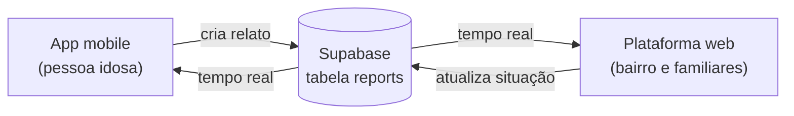
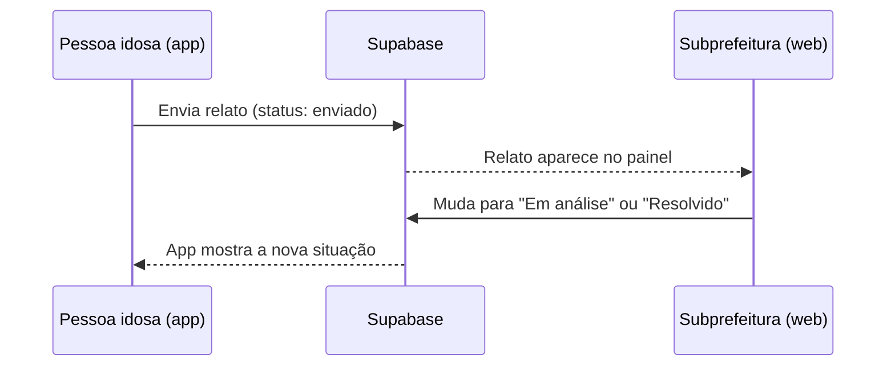

<div align="center">

# Bairro Cuidado

**Zeladoria colaborativa para quem mais precisa de calçadas seguras.**

Um aplicativo mobile e uma plataforma web, conectados em tempo real, para que pessoas idosas relatem, acompanhem e se informem sobre problemas nos espaços públicos do bairro onde vivem.


[**Plataforma web**](https://bairro-cuidado.vercel.app/) · [**Documento do projeto**](docs/bairro-cuidado-documento-do-projeto.pdf) · [**Código do app**](app) · [**Código da web**](web)

</div>

---

## Sumário

- [Visão geral](#visão-geral)
- [O problema](#o-problema)
- [A solução](#a-solução)
- [Quem participa](#quem-participa)
- [Funcionalidades](#funcionalidades)
- [Arquitetura e integração](#arquitetura-e-integração)
- [Princípios de design](#princípios-de-design)
- [Motion design](#motion-design)
- [Acessibilidade](#acessibilidade)
- [Tecnologias](#tecnologias)
- [Estrutura do repositório](#estrutura-do-repositório)
- [Como rodar](#como-rodar)
- [Como testar a integração](#como-testar-a-integração)
- [Limitações e próximos passos](#limitações-e-próximos-passos)
- [Autoria](#autoria)

---

## Visão geral

> Para a maioria das pessoas, um buraco na calçada é um incômodo. Para uma pessoa idosa, pode ser uma queda, um caminho evitado ou a decisão de não sair de casa.

O **Bairro Cuidado** encurta o caminho entre quem encontra o problema e quem pode resolvê-lo, e devolve a quem relatou uma resposta clara sobre o que aconteceu depois.

| | App mobile | Plataforma web |
|---|---|---|
| **Para quem** | Pessoa idosa (60+) | Subprefeitura, associação de moradores, vizinhos e familiares |
| **Objetivo** | Relatar em poucos passos e acompanhar | Enxergar o bairro, priorizar e dar retorno |
| **Por que existe** | Quem vive o problema precisa de simplicidade | Quem resolve precisa de visão do conjunto e controle |

## O problema

Calçadas quebradas, buracos, iluminação apagada, lixo em local irregular, mato alto em praças e árvores com risco de queda fazem parte do cotidiano de muitos bairros. Os canais para relatar costumam ser pouco claros, exigem muitos passos e raramente informam o que aconteceu depois.

## A solução

Duas plataformas, uma única fonte de dados. O relato nasce no app e aparece no painel da web na hora. Quando a situação muda na web, o app mostra a mudança e o aviso da equipe.

## Quem participa

| Ator | Papel | Plataforma |
|---|---|---|
| Pessoa idosa | Relata e acompanha | App |
| Familiar | Acompanha os relatos de quem ama | Web |
| Vizinho | Vê o que já foi relatado, evitando repetição | Web |
| Associação de moradores | Organiza as demandas e cobra a solução | Web |
| Subprefeitura | Analisa e atualiza a situação | Web |

## Funcionalidades

### Aplicativo mobile

| Tela | O que oferece |
|---|---|
| **Início** | Dois caminhos claros: relatar um problema ou acompanhar relatos |
| **Qual é o problema?** | Seis categorias em botões grandes com ícone e texto, local e nome |
| **Relato enviado** | Confirmação visual de que deu certo |
| **Relatos do bairro** | Lista com a situação de cada relato e os avisos da equipe |

Categorias: buraco na rua, calçada quebrada, luz apagada, lixo no lugar errado, mato alto e árvore em risco.

### Plataforma web

| Visão | O que oferece |
|---|---|
| **Painel do bairro** | Resumo por situação, filtros por situação e problema, e troca da situação de cada relato |
| **Acompanhar um familiar** | Lista apenas os relatos de uma pessoa, buscando pelo nome |

Situações: **Enviado**, **Em análise** e **Resolvido**, sempre com ícone e texto.

## Arquitetura e integração





**Tabela `reports`**

| Campo | Descrição |
|---|---|
| `id` | Identificador do relato |
| `category` | Tipo do problema |
| `description` | Detalhes opcionais |
| `place` | Local informado |
| `author` | Nome de quem relatou |
| `status` | `enviado`, `analise` ou `resolvido` |
| `note` | Aviso da equipe |
| `created_at` | Data do relato |

Os dados iniciais são simulados (`supabase.sql`), mas o fluxo entre as plataformas funciona de verdade.

## Princípios de design

1. **Poucos passos.** Cada tela tem uma tarefa.
2. **Texto sempre junto do ícone.** Nada depende de adivinhar o que um símbolo significa.
3. **Retorno em toda ação.** Quem toca em um botão vê o que mudou.
4. **Linguagem do dia a dia.** Frases curtas e verbos diretos.
5. **Calma.** Cores sóbrias, espaço de sobra e movimento suave.

Paleta: azul-petróleo `#0B5563`, azul-escuro `#0B3C47`, fundo `#F3F6F8` e âmbar `#8A4B08` para a situação dos relatos. Na web, a fonte é a **Atkinson Hyperlegible**, criada para facilitar a leitura.

## Motion design

| Onde | O que acontece | Função na jornada |
|---|---|---|
| App: troca de tela | Fade com leve subida (~0,45 s) | Orientar a navegação |
| App: envio do relato | Confirmação aparece suavemente | Dar retorno da ação |
| App: categoria escolhida | Borda, fundo e marca mudam | Mostrar o estado selecionado |
| Web: cards de relatos | Entrada suave (~0,4 s) | Evitar que a lista surja de repente |
| Web: mudança de situação | Aviso em texto, lido por leitores de tela | Confirmar a ação |

Todo movimento é desligado quando o aparelho ou o navegador está com a opção **reduzir movimento**.

## Acessibilidade

| Critério | Como é atendido |
|---|---|
| Contraste | Texto escuro sobre fundo claro; botões com texto branco sobre azul-petróleo |
| Texto ampliável | App acompanha o tamanho de fonte do aparelho; web usa medidas relativas |
| Sem depender só de cor | Situação sempre com ícone e texto; categoria escolhida com borda e marca |
| Leitores de tela | Rótulos e papéis em botões, campos e cards |
| Toque no app | Áreas de no mínimo 60 pt, bem espaçadas |
| Web | HTML semântico, navegação por teclado, foco visível e link "Pular para os relatos" |
| Sensibilidade a movimento | Animações desligadas com "reduzir movimento" |
| Linguagem | Simples e direta |

## Tecnologias

| Camada | Tecnologia |
|---|---|
| App | React Native com Expo |
| Web | React + Vite (HTML, CSS e JavaScript) |
| Dados e tempo real | Supabase (PostgreSQL) |
| Hospedagem da web | Vercel |
| Versionamento | Git e GitHub |

## Estrutura do repositório

```
zeladoria/
├── app/               Aplicativo mobile (Expo)
│   ├── App.js         Telas e lógica do app
│   └── supabase.js    Conexão com o Supabase
├── web/               Plataforma web (Vite + React)
│   ├── src/           Componentes e estilos
│   └── .env.example   Modelo das variáveis de ambiente
├── docs/              Documento do projeto (PDF)
├── supabase.sql       Tabela, permissões e dados de exemplo
└── README.md
```

## Como rodar

### Pré-requisitos

- [Node.js](https://nodejs.org) (versão LTS)
- [Git](https://git-scm.com)
- Conta gratuita no [Supabase](https://supabase.com)
- App **Expo Go** no celular (para testar o aplicativo)

### 1. Banco de dados

1. Crie um projeto no Supabase.
2. No **Editor SQL**, cole o conteúdo de `supabase.sql` e execute.
3. Em **Project Settings → API**, copie a **Project URL** e a chave **anon / publishable**.

### 2. Plataforma web

```bash
cd web
cp .env.example .env     # no Windows PowerShell: Copy-Item .env.example .env
```

Preencha o `.env`:

```
VITE_SUPABASE_URL=https://SEU-PROJETO.supabase.co
VITE_SUPABASE_KEY=SUA-CHAVE
```

```bash
npm install
npm run dev
```

Abra `http://localhost:5173`.

**Publicação na Vercel:** importe o repositório, defina **Root Directory** como `web` e cadastre as duas variáveis acima.

### 3. Aplicativo mobile

1. Preencha a URL e a chave em `app/supabase.js`.
2. Em `app/package.json`, deixe a entrada principal como:
   ```json
   "main": "node_modules/expo/AppEntry.js"
   ```
3. Instale e rode:
   ```bash
   cd app
   npm install
   npx expo start -c
   ```
4. Escaneie o QR code com o **Expo Go**, com o celular na mesma rede Wi-Fi do computador. Se a rede bloquear a conexão, use `npx expo start --tunnel`.

## Como testar a integração

1. Abra a [plataforma web](https://bairro-cuidado.vercel.app/) em **Painel do bairro**, com os filtros em "Todas" e "Todos".
2. No app, faça um relato novo. Ele deve aparecer na web sem recarregar a página.
3. Na web, mude a situação do relato para **Em análise** ou **Resolvido**.
4. No app, abra **Acompanhar relatos**. A nova situação e o aviso devem aparecer.

## Limitações e próximos passos

- Ainda não há login: o nome é informado no relato.
- As regras de acesso do banco estão abertas para a demonstração. Em um produto real, só a equipe autorizada poderia alterar a situação.
- Evoluções planejadas: foto do problema, mapa dos relatos, localização automática, notificações e tela de detalhe de cada relato.

## Autoria

**Diana Ramos**
Projeto individual da **Sub Global Solution | CitizenTech**.

[github.com/DianaRamos26](https://github.com/DianaRamos26)
